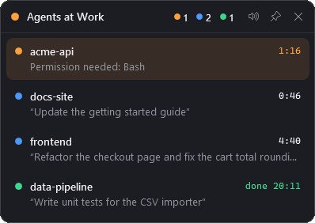

<p align="center">
  
</p>

<p align="center">
  <b>Vedi a colpo d'occhio tutte le sessioni di Claude Code, con un avviso sonoro quando un task è finito.</b><br>
  <a href="README.md">English</a> · <a href="docs/ARCHITECTURE.md">Architettura (EN)</a> · <a href="PRIVACY.md">Privacy</a>
</p>

<p align="center">
  
</p>

Se usi più sessioni di Claude Code insieme (terminali, pannelli di VS Code), finisci per saltare da una finestra all'altra solo per controllare se una ha finito o è ferma su una richiesta di permesso. LePa Sentinel vive nell'area di notifica e te lo dice lui.

## Funzioni

- **Icona nella tray con lo stato in tempo reale**: il colore dello stato più urgente e il numero di task attivi.
  🟠 aspetta te · 🔵 al lavoro · 🟢 fatto · ⚪ niente in corso
- **Pannello** (clic sull'icona): una scheda per sessione con progetto, prompt, tempo trascorso e stato. Si chiude quando clicchi altrove, oppure puoi **fissarlo** sullo schermo, sempre in primo piano.
- **Suoni**: uno morbido quando un task è finito, uno più insistente quando Claude chiede un permesso o una risposta. Si possono disattivare.
- **Clic su una scheda**: porta in primo piano la finestra di VS Code o del terminale di quella sessione.
- **Niente doppioni**: ogni sessione è legata al suo processo `claude.exe`. Le sessioni chiuse spariscono e i processi "di riserva" di VS Code vengono ignorati.
- Interfaccia in italiano e inglese: segue la lingua di Windows, oppure si forza con `LEPA_SENTINEL_LANG=it|en`.
- Tutto in locale: nessun accesso alla rete, nessuna telemetria.

### L'icona nella tray

<p align="center">
  
</p>

Il numero nell'icona indica quante sessioni sono **al lavoro o aspettano te**; il colore è lo stato più urgente.

## Installazione

| Opzione | |
|---|---|
| **Microsoft Store** | *in arrivo* |
| **Installer** | Scarica `LePa-Sentinel-Setup-x.y.z-x64.exe` dalle [Release](https://github.com/emanueleparini/LePa-Sentinel/releases). Si installa per l'utente corrente, senza diritti di amministratore. |
| **Portable** | Scarica lo `.zip` dalle Release, estrailo dove vuoi e avvia `LePaSentinel.exe`. |

Requisiti: Windows 10 1809 o successivo / Windows 11 (x64) e [Claude Code](https://docs.claude.com/en/docs/claude-code/overview). Non serve installare .NET: il runtime è incluso.

Al primo avvio LePa Sentinel chiede di **collegarsi a Claude Code**. Questo aggiunge alcuni [hooks](https://docs.claude.com/en/docs/claude-code/hooks) alle tue impostazioni utente (`%USERPROFILE%\.claude\settings.json`, oppure `CLAUDE_CONFIG_DIR` se impostata), dopo averne salvato una copia di backup. Le sessioni avviate da quel momento compaiono nel pannello. Puoi scollegarlo quando vuoi dal menu della tray, e disinstallando gli hooks vengono rimossi.

> Windows può nascondere le nuove icone sotto la freccia `^`: trascina l'icona sulla barra delle applicazioni, oppure attivala in *Impostazioni → Personalizzazione → Barra delle applicazioni → Altre icone della barra di sistema*.

## Come funziona

| Evento di Claude Code | Stato |
|---|---|
| `UserPromptSubmit` | al lavoro |
| `Notification` (permesso / domanda) | aspetta te |
| `PostToolUse` dopo un permesso | di nuovo al lavoro |
| `Stop` | fatto (inattivo dopo 30 minuti) |
| `SessionEnd`, o il processo termina | rimossa |

Ogni chiamata dell'hook dura circa 0,1 s, non scrive nulla su stdout e non fallisce mai, quindi non rallenta né blocca Claude Code. I dettagli sono in [docs/ARCHITECTURE.md](docs/ARCHITECTURE.md).

**Limite noto:** se interrompi Claude con Esc, Claude Code non invia nessun evento e la scheda resta "al lavoro". Dopo 5 minuti senza attività mostra "fermo?".

## Menu della tray

Apri pannello · Fissa sullo schermo · Audio · Prova suoni · Avvia con Windows · Collegato a Claude Code · Rimuovi sessioni concluse · Informazioni · Esci

## Compilare dai sorgenti

Servono .NET 8 SDK e, per la build completa, Inno Setup 6 e Windows 10/11 SDK.

```powershell
git clone https://github.com/emanueleparini/LePa-Sentinel.git
cd LePa-Sentinel
dotnet run --project src            # esecuzione in sviluppo

./build.ps1                         # publish autonomo + zip portable + installer → ./artifacts
./build.ps1 -Msix                   # anche il pacchetto MSIX per il Microsoft Store
./build.ps1 -Sign                   # firma con Azure Artifact Signing (maintainer)
```

`LePaSentinel.exe --install-hooks` / `--uninstall-hooks` collegano e scollegano da riga di comando.

## Licenza

[MIT](LICENSE) © 2026 LePa s.r.l.

*LePa Sentinel è un progetto indipendente, non affiliato né approvato da Anthropic. Claude e Claude Code sono marchi di Anthropic, PBC.*
