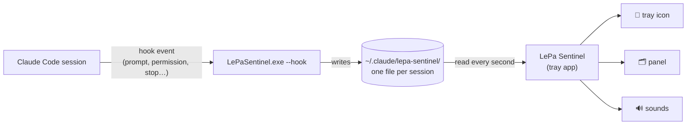

<p align="center">
  
</p>

<p align="center">
  <a href="https://github.com/emanueleparini/LePa-Sentinel/releases/latest"></a>
  <a href="https://github.com/emanueleparini/LePa-Sentinel/actions/workflows/build.yml"></a>
  
  
  <a href="LICENSE"></a>
</p>

<p align="center">
  <b>See every Claude Code session at a glance — and hear a chime when a task is done.</b><br>
  <a href="#install">Install</a> · <a href="#how-it-works">How it works</a> · <a href="docs/ARCHITECTURE.md">Architecture</a> · <a href="PRIVACY.md">Privacy</a> · <a href="README.it.md">Italiano</a>
</p>

---

## Why

If you run several [Claude Code](https://docs.claude.com/en/docs/claude-code/overview) sessions at once, in terminals or in VS Code, you keep switching windows just to check:

- *has it finished yet?*
- *is it stuck waiting for my permission?*
- *which one was working on what?*

**LePa Sentinel** sits in the Windows notification area and answers those questions for you. Glance at the tray icon, click it for details, and get back to work when a session needs you.

<p align="center">
  
</p>

## Features

| | |
|---|---|
| 🔔 **Live tray icon** | Shows the colour of the most urgent state and the number of active tasks. |
| 🗂️ **One card per session** | Project, prompt, elapsed time and status. Sessions waiting for you are listed first. |
| 🔊 **Sounds** | A soft chime when a task is done, a distinct alert when Claude needs your permission or input. One click to mute. |
| 🎯 **Jump to the session** | Click a card to bring that session's VS Code or terminal window to the front. |
| 📌 **Pop-up or pinned** | The panel opens from the tray and closes when you click elsewhere, or pin it on screen, always on top. |
| 🧹 **No clutter** | Sessions are tied to their `claude.exe` process: closed sessions disappear and VS Code's idle spare processes are ignored. |
| 🌍 **English & Italian** | Follows the Windows language (override with `LEPA_SENTINEL_LANG=en` or `it`). |
| 🔒 **Local only** | No account, no network access, no telemetry. |

### Tray icon at a glance

<p align="center">
  
</p>

The number inside the icon is how many sessions are **working or waiting for you**. The colour is the most urgent state across all sessions.

## Install

| | |
|---|---|
| 🛍️ **Microsoft Store** | *Coming soon.* |
| 💿 **Installer** (recommended) | Download `LePa-Sentinel-Setup-x.y.z-x64.exe` from the [latest release](https://github.com/emanueleparini/LePa-Sentinel/releases/latest). It installs for the current user, no admin rights needed. Signed by LePa s.r.l. |
| 📦 **Portable** | Download the `.zip` from the release, extract it anywhere and run `LePaSentinel.exe`. |

**Requirements:** Windows 10 1809+ or Windows 11 (x64) and Claude Code. No .NET installation needed: the runtime is included.

### First start

1. LePa Sentinel asks to **connect to Claude Code**. This adds a few [hooks](https://docs.claude.com/en/docs/claude-code/hooks) to your Claude Code user settings (`%USERPROFILE%\.claude\settings.json`, or `%CLAUDE_CONFIG_DIR%`). A backup copy is saved first. The installer can do this for you.
2. **Restart your Claude Code sessions**: Claude Code loads hooks when a session starts.
3. Send a prompt: the session appears in the panel.

> [!TIP]
> Windows may hide new tray icons under the `^` arrow. Drag the icon onto the taskbar, or turn it on in *Settings → Personalization → Taskbar → Other system tray icons*.

## How it works



Claude Code runs a small command on each [hook event](https://docs.claude.com/en/docs/claude-code/hooks). LePa Sentinel uses its own executable for that, in a fast mode that only updates a tiny status file and exits. The tray app watches those files.

| Claude Code event | Session status |
|---|---|
| `UserPromptSubmit` | 🔵 working |
| `Notification`: permission or question | 🟠 waiting for you (+ alert sound) |
| `PostToolUse` after a permission | 🔵 working again |
| `Stop` | 🟢 done (+ chime), ⚪ idle after 30 minutes |
| `SessionEnd`, or the Claude process exits | removed |

- Each hook call takes about **0.1 s**, prints nothing and never fails, so it cannot slow down or break Claude Code.
- Nothing leaves your computer. See [PRIVACY.md](PRIVACY.md) for exactly what is stored.
- For the internals, see [docs/ARCHITECTURE.md](docs/ARCHITECTURE.md).

## Usage

| Action | Result |
|---|---|
| Left-click the tray icon | Open / close the panel |
| Click a session card | Bring its VS Code or terminal window to the front |
| Right-click a session card | Go to window · Open folder · Remove from list |
| 🔊 in the panel header | Mute / unmute |
| 📌 in the panel header, or drag the header | Pin the panel on screen (always on top) |
| Right-click the tray icon | Open panel · Pin on screen · Sound · Test sounds · Start with Windows · Connected to Claude Code · Clear finished sessions · About · Exit |

## FAQ

<details>
<summary><b>A session I closed is still in the list / a session doesn't appear</b></summary>

Sessions appear after their first prompt, and only if they were **started after** LePa Sentinel connected to Claude Code (restart older sessions). A session disappears when Claude Code ends it or when its process exits. You can also right-click a card → *Remove from list*.
</details>

<details>
<summary><b>The card says "stalled?"</b></summary>

When you interrupt Claude with <kbd>Esc</kbd>, Claude Code sends no event, so the session still looks busy. After 5 minutes without activity the card shows *stalled?*. It updates at your next prompt.
</details>

<details>
<summary><b>How do I disconnect or uninstall?</b></summary>

Right-click the tray icon → uncheck *Connected to Claude Code* to remove the hooks. Uninstalling from *Settings → Apps* also removes the hooks and the app's data. Your other Claude Code settings are never touched.
</details>

<details>
<summary><b>Does it work with the Claude Code VS Code extension?</b></summary>

Yes. The extension and the CLI share the same hooks, and clicking a card brings the right VS Code window to the front.
</details>

## Build from source

Requirements: [.NET 8 SDK](https://dotnet.microsoft.com/download/dotnet/8.0); for the full build also [Inno Setup 6](https://jrsoftware.org/isinfo.php) and the Windows 10/11 SDK.

```powershell
git clone https://github.com/emanueleparini/LePa-Sentinel.git
cd LePa-Sentinel

dotnet run --project src      # run in development
./build.ps1                   # self-contained publish + portable zip + installer → ./artifacts
./build.ps1 -Msix             # also the Microsoft Store MSIX package
```

`LePaSentinel.exe --install-hooks` and `--uninstall-hooks` connect and disconnect from the command line.

## Contributing

Bug reports, ideas and pull requests are welcome. Please read [CONTRIBUTING.md](CONTRIBUTING.md) first. Security issues: see [SECURITY.md](SECURITY.md).

## License

[MIT](LICENSE) © 2026 LePa s.r.l.

<sub>LePa Sentinel is an independent project, not affiliated with or endorsed by Anthropic. Claude and Claude Code are trademarks of Anthropic, PBC.</sub>
